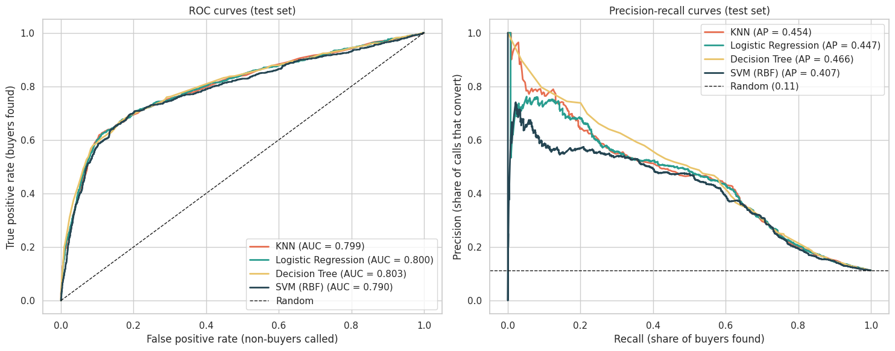
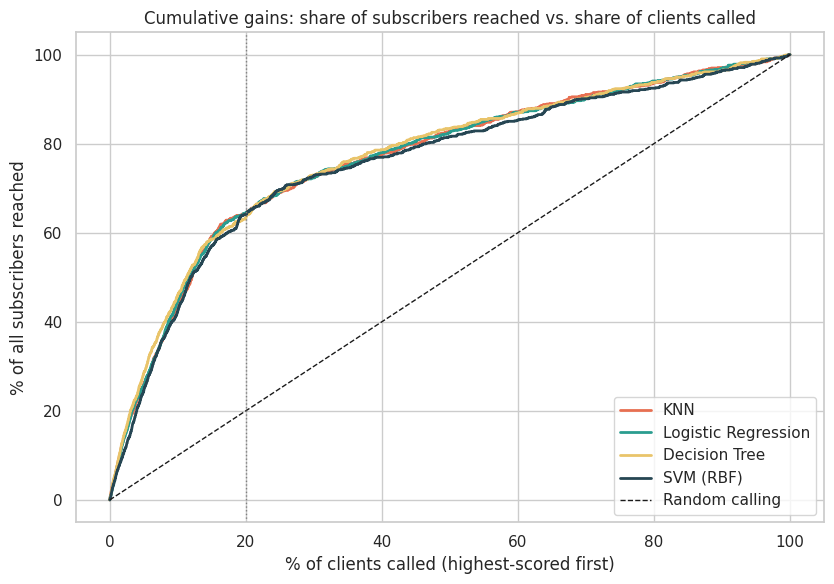

# Comparing Classifiers for Bank Term-Deposit Telemarketing

Which clients should a bank's call center phone first? This project compares **K-Nearest Neighbors, Logistic Regression, Decision Trees and Support Vector Machines** on the UCI *Bank Marketing* data (41,188 calls from a Portuguese bank, May 2008 – Nov 2010) and recommends one for ranking a call list.

**Full analysis: [`bank_marketing_classifier_comparison.ipynb`](bank_marketing_classifier_comparison.ipynb)**
It follows CRISP-DM: business understanding, EDA with descriptive and inferential statistics, data preparation, modeling with cross-validated grid search, evaluation, robustness checks, findings, and next steps.

## Business problem
Only ~11% of calls end in a subscription. The bank wants to make fewer calls while keeping most of the sales. This is framed as a **ranking problem**: score every client on the information available *before* dialing, then call from the top of the list down.

## Approach in brief
- **Target:** `y` (subscribed to a term deposit, 1/0); 11.3% positive (imbalanced).
- **`duration` (call length) excluded.** It is only known after the call, so including it leaks the answer (AUC ≈ 0.94 with it vs ≈ 0.80 without; shown in the notebook).
- **Cleaning:** removed 12 duplicates; kept `"unknown"` as a category; replaced the `pdays = 999` sentinel with clean features; capped `campaign` at 10.
- **Pipeline:** scaling + one-hot encoding inside each model pipeline (no leakage in cross-validation); stratified 80/20 train/test split.
- **Tuning:** 5-fold stratified `GridSearchCV` per model. The SVM grid was searched on a 6,000-row subsample for speed and refit on all training data.
- **Primary metric: ROC-AUC**, because the goal is ranking and accuracy is misleading at 89/11 class balance (an "always no" model is 88.7% accurate). Also reported: PR-AUC, precision/recall/F1, and cumulative gains (share of subscribers reached by calling the top X% of the list).

## Results (held-out test set, 8,236 clients)

| Model | Test ROC-AUC | CV ROC-AUC | Reach with top 20% of list | Chronological-test AUC* |
|---|---|---|---|---|
| Logistic Regression | 0.800 | 0.791 | 64% | **0.751** |
| Decision Tree | 0.803 | 0.786 | 63% | 0.517 |
| KNN | 0.799 | 0.788 | 64% | 0.716 |
| SVM (RBF) | 0.790 | 0.776 | 64% | 0.635 |

\*Train on the first 80% of calls in time, test on the last 20%: a stress test for whether a model holds up as conditions change.




## Key findings
1. **The four models are statistically tied on accuracy** (differences of about 0.01 AUC are within cross-validation noise). Tuning mattered a lot for the tree, SVM and KNN, and little for logistic regression.
2. **Recommendation: Logistic Regression.** Equal ranking performance, trains almost instantly, is explainable, and is by far the most stable over time. The decision tree collapses to near-random on the chronological test because it leans on exact economic thresholds.
3. **Efficiency gain:** calling the top 20% of the ranked list reaches about **64% of subscribers** (random: 20%); the top 10% reaches about 44%.
4. **What drives subscription:** previous-campaign success (65% vs 9% for first-timers), mobile vs landline contact (14.7% vs 5.2%), low-interest-rate/economic conditions, being a student or retiree, and fewer repeat calls. Day of week, housing loan and personal loan add little.
5. **Limits:** about 1 in 3 flagged clients converts, and ~36% of subscribers fall outside the top 20%. The data is from the 2008–2010 financial crisis, so patterns may not carry over to today.

## Recommendations
- Rank the call list with the logistic regression score and start with the top 20–30%.
- Prioritize past subscribers, students and retirees, and mobile numbers; cap repeat attempts.
- Set the call cut-off from the cost per call and value per deposit, not the default 0.5.
- Validate with an A/B pilot, add richer client data (balance, tenure, products), monitor drift, and calibrate probabilities.

See Sections 7 and 8 of the notebook for the full findings and next steps.

## Repository structure
```
├── README.md
├── bank_marketing_classifier_comparison.ipynb   # full analysis
├── requirements.txt
├── data/
│   ├── bank-additional-full.csv                 # dataset (semicolon-separated)
│   └── bank-additional-names.txt                # data dictionary and citation
└── images/                                      # figures used in this README
```

## Reproducing
```bash
pip install -r requirements.txt
jupyter notebook bank_marketing_classifier_comparison.ipynb
```
Run all cells top to bottom (about 15–20 minutes on a single CPU core, mostly the SVM and KNN grid searches).

## Data source and citation
UCI Machine Learning Repository, *Bank Marketing* (with social/economic context).
S. Moro, P. Cortez and P. Rita. *A Data-Driven Approach to Predict the Success of Bank Telemarketing.* Decision Support Systems, 2014.
